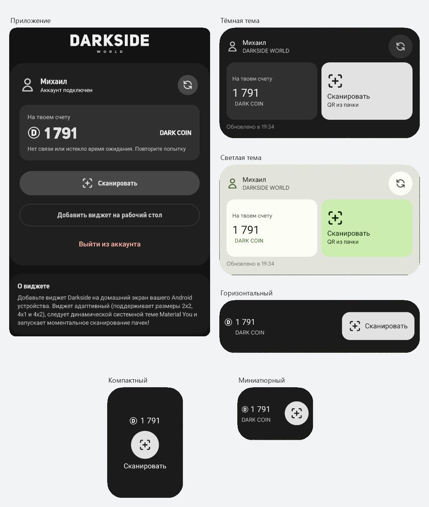

# Dark Coin Widget

**Dark Coin** — неофициальное Android-приложение с виджетом для [DARKSIDE WORLD](https://darkside-world.com/). Создано, чтобы сканировать QR-коды из пачек прямо с рабочего стола и видеть баланс Dark Coins без постоянного открытия сайта.

## Возможности

- Быстрый запуск сканера из приложения или виджета.
- Вход в аккаунт DARKSIDE WORLD и просмотр баланса Dark Coins.
- Адаптивный виджет: от компактной кнопки до панели с профилем, балансом и временем обновления.
- Светлая и тёмная темы, системные цвета Material You на совместимых устройствах.

## Установка

Скачайте APK из релизов проекта и установите его на телефон. Откройте **Dark Coin**, войдите в аккаунт DARKSIDE WORLD и добавьте виджет на рабочий стол.

Нужны **Android 8.0 или новее**, сервисы Google Play для сканирования и подключение к интернету для входа, отправки QR-кодов и обновления баланса. Доступные размеры виджета зависят от лаунчера и сетки рабочего стола.

## Скриншоты

Приложение и виджеты разных размеров в светлой и тёмной темах. Виджеты показаны в одинаковом масштабе.

## Независимость проекта

Dark Coin Widget — личный любительский проект автора. Автор не связан с брендом DARKSIDE, его правообладателями и командой DARKSIDE WORLD и не представляет их интересы. Приложение не является официальным продуктом DARKSIDE; его выпуск не означает одобрения или поддержки со стороны бренда.

Названия DARKSIDE и DARKSIDE WORLD, логотипы и другие обозначения принадлежат соответствующим правообладателям. Их использование в приложении и документации служит для обозначения сервиса, с которым работает приложение, и не означает передачи каких-либо прав на них.

Работа приложения зависит от стороннего сервиса DARKSIDE WORLD и может измениться при обновлении его сайта, API или правил. Автор не управляет аккаунтами, начислением Dark Coins и доступностью сервиса. Приложение предоставляется «как есть», без гарантий бесперебойной работы, в пределах, допускаемых применимым законодательством.
